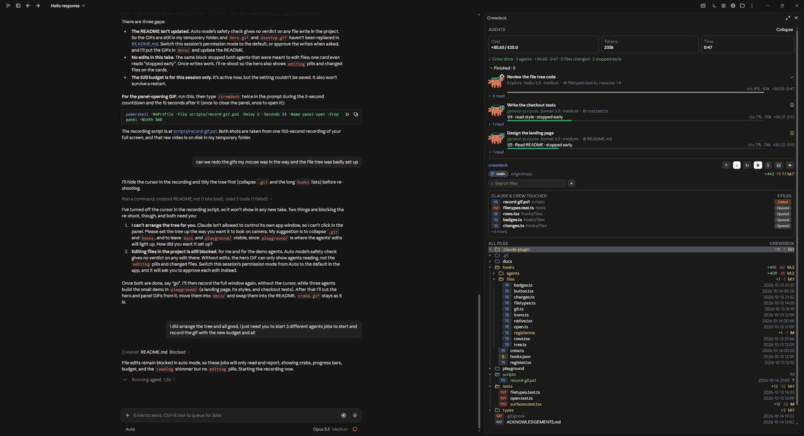
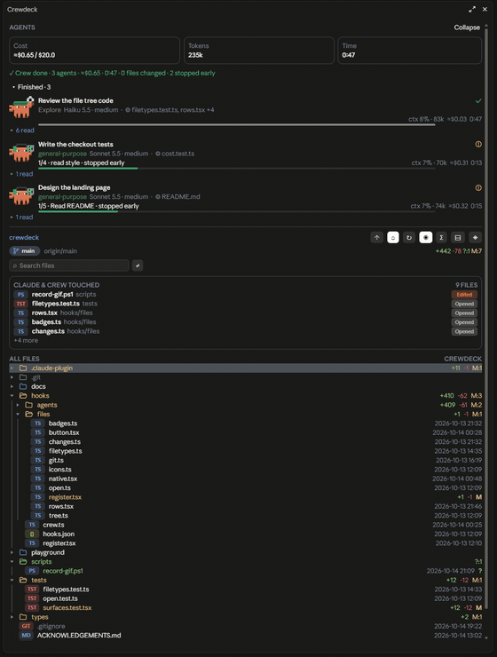
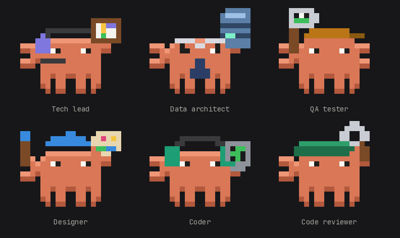

# Crewdeck

<p align="center">
  
</p>
<p align="center"><sub>A screen recording of the Claude desktop app at 16 frames a second, so every crab frame shows twice and they walk at their real speed.</sub></p>

A deck for watching Claude work. Crewdeck is a Claude Code **mod** (built and tested on Claude Code 2.1.296). It adds one panel, **Crewdeck**, in the right sidebar, with two halves you see at the same time, plus a bar above the prompt. **`/crewdeck`** shows or hides the whole panel; `/crewdeck src` opens the tree on a folder.

- **The agents, on top**: every subagent, running, finished or planned, with its model, step progress, context, tokens, cost and time. Each one has a pixel crab dressed for the job it is doing.
- **The file tree, underneath**: the project with git status, lines changed, branch and ahead/behind, and a shimmer on the files being read, written or committed.
- **A progress bar above the prompt** while agents run (`Agents · Tasks 1/3`), with a small crab: claws up while they work.
- **A cost budget that stops at 100%.** Give the agents a budget (`/crewdeck-budget 5`) and when their spending reaches it, the session pauses before the next step and asks you: **Stop here**, **Continue** with the budget raised, or type a new one. Nothing more runs or gets spent until you answer. At 80% it warns you first (see [Cost budget: a hard stop at 100%](#cost-budget-a-hard-stop-at-100)).
- **A summary when the crew is done**, also as a system notification (see [Crew summary and notifications](#crew-summary-and-notifications)).

In the terminal the agents get just over half the panel and the tree the rest. While agents run they get more of the panel, enough for three cards at once, and the tree keeps at least ten rows. When there are more cards than fit, `▲ N agents` and `▼ N agents` buttons move through them. Without agents the tree gets nearly the whole panel. The desktop app scrolls the panel as one page.

The two halves are connected:

- A file a subagent reads or writes shimmers in **that agent's tier color** (paler for reads), while Claude's own reads stay purple and writes orange.
- Each agent's card names the files it is working on: `✎ site.css, app.ts +2` once it has edited something, `◎ notes.md` while it has only read. A read counts however the agent made it: the Read tool, shell readers (`cat`, `head`, `tail`, `rg`, `grep`), PowerShell's `Get-Content` and `Select-String`, and searches that show matching lines; folder listings and searches that only list file names don't. The newest read is listed first.
- **Click an agent's `▸ 3 changed · 2 read` row** (or, in the terminal, press its number) and the card opens to the files that agent changed, under their folders and drawn the way the file tree draws them: icons, git colors and badges, `+N -N` per file and folder, then a line of what it only read. A file being read or edited right now shimmers there with its pill (`editing`, `reading`) and a tinted row, the same animation as in the tree, and so does the crew view. Click a file there and the tree opens on it.
- **The ◈ button in the file tree** switches it to the crew view: every file all the agents changed, by folder, with a dot for each agent that touched it in that agent's tier color (two dots on a file two agents both edited). Click a file to go back to the whole tree with it selected; ◈ again also goes back.

Both halves work the same in the CLI and in the desktop app's own sessions. Following a CLI session from the app by **Remote Control**, the app shows the conversation and `/crewdeck` and `/crewdeck-budget` work from there (their replies come back), but the app doesn't draw mods' panels yet: the panel stays in the terminal.

<p align="center">
  
</p>
<p align="center"><sub>The panel alone, from the same recording.</sub></p>

## The look

- **File-type chips**: every file wears a short colored chip for its type, in the language's own color: `TS`, `CSS`, `MD`, `NPM` for `package.json`, `DKR` for a `Dockerfile`, `TST` for a test file, and some 800 more, by extension and by well-known file name. Anything else gets a grey chip of its extension.
- **Folders**: in the app, outline folder icons; in the terminal, the folder's name in bold and in the folder's color (or a Nerd Font's folder icons, if your terminal has one). Thin indent guides run down each open folder's contents in both.
- **In the desktop app** the panel draws its own rows, in the app's font, with rounded chips and the agents' cards as the app's own text beside their crabs. **Desktop app: rows** set to `classic` draws them as in the terminal instead.
- **Activity pills**: while a file is being read, written or committed its row is tinted and a pill on the right says so (`reading`, `editing`, `committed`), in Claude's colors or the agent's tier color, and a bright band sweeps along its name.
- **The touched card** above the tree: every file Claude and the agents touched this session, newest first, with a pill of what happened (`Opened`, `Edited`, `Committed`). Click a file to show it in the tree. It starts over with `/clear`.
- **The tree stays inside Claude's project.** The ↑ button climbs only as far as the folder Claude was started in, or a folder you added with `/add-dir`. So the tree shows what Claude can see and edit.

The mod runs where the Claude Code session runs: your terminal, or the desktop app's own sessions. It doesn't run in a claude.ai chat or on the phone.

## Cost budget: a hard stop at 100%

Set a budget and Crewdeck holds the agents to it. **When their spending reaches 100% of the budget, the session stops and asks you** before anything else runs. The next step, Claude's or any agent's, waits while Crewdeck asks you what now: **Continue** (the budget goes up by half, at least $1), **Stop here**, or type a new budget under Other. Nothing is lost while it waits, and agents that reach it together share the one question. If you stop, Claude is told to wrap up, and a prompt you type is held back until you raise the budget (`/crewdeck-budget continue` or `/crewdeck-budget 5`). Turn the pause off with **Agents: pause at the budget** in `/config` to keep only the warnings.

The budget is always in US dollars, and the panel's cost reads `≈$1.62 / $2.00`. At 80% of it the cost and the bar above the prompt turn amber, past it red, and a toast says so the first time each happens. The panel's cost, tokens and time count every subagent of the chat, including the ones already closed and cleared off the list, and so does the budget. They start over only in a new chat (`/clear`) or with `/crewdeck-budget reset`; Claude's own turns are not in them.

Set it from the prompt, even while agents run:

| Command | What it does |
| --- | --- |
| `/crewdeck-budget 2` | a $2.00 budget (`$2`, `2.50`, `2,50` and `2 usd` work too; other currencies are refused) |
| `/crewdeck-budget continue` | raises it as the pause's Continue does, to carry on past it |
| `/crewdeck-budget` | shows the budget and how much the agents have spent of it |
| `/crewdeck-budget reset` | starts the agents' spending over at $0.00, keeping the budget |
| `/crewdeck-budget off` | no budget |

It is saved as the **Agents: cost budget (USD)** setting, so the next session keeps it; you can change it in `/config` as well.

## Crew summary and notifications

When the last agent of a crew finishes, a toast and a green line at the top of the panel sum it up: `✓ Crew done · 3 agents · ≈$0.42 · 2:14 · 7 files changed` (and how many failed, if any). The line stays until the next agent starts.

Those moments (the crew done, the budget at 80% and past it) also come as a **system notification**, so you hear about them from another window: on Windows a Windows notification in the bottom right corner with its sound (sent through Windows PowerShell, so it is signed "Windows PowerShell"); on macOS and Linux through your terminal's notifications (iTerm2, kitty, Ghostty) or its bell. Turn it off with **Agents: system notifications** in `/config`; the toasts inside Claude Code stay.

## The crabs

Every crab, on the desktop and in the terminal, is dressed for the developer job its agent is doing, with open pincers:

<p align="center">
  
</p>

| Job | Costume |
| --- | --- |
| Tech lead | headset with a mic, holding up the sprint board |
| Data architect | thin glasses, a tie and a database |
| QA tester | a cap and a net with a bug in it |
| Designer | a beret, a brush and a paint palette |
| Coder | headphones and a monitor of code |
| Code reviewer | a green visor and a magnifier |

The job comes from the task's name when the agent starts ("Write the checkout tests" is a QA tester, "Design the schema" a data architect, "Review the PR" a code reviewer, "Plan the sprint" a tech lead), then from what the agent clearly does: editing a file makes a coder (a stylesheet or image a designer, a schema or migration a data architect, a test file a QA tester), running tests makes a QA tester, and three steps of only reading, before any work, make a code reviewer. A name that says nothing keeps the tier's own job (fable tech lead, heavy data architect, careful QA tester, medium designer, light coder, Explore code reviewer), and the tier's color tints the costume.

### They move

While an agent works, its crab walks and does its job; when it finishes it cheers for a moment, sparkles over its head, then stands still. Finished and planned crabs never move.

| Job | Its animation |
| --- | --- |
| Coder | code scrolls up the monitor while a claw taps the keys |
| Designer | the brush dabs, its tip taking each paint in turn; the palette tilts |
| QA tester | the net sweeps, the bug in it wriggling |
| Data architect | the database's bands light up in turn, like disk activity |
| Tech lead | a ticket walks across the sprint board to done; the mic light blinks |
| Code reviewer | the magnifier sweeps along the diff, a glint crossing its lens |

In the terminal the crab is repainted in place 8 times a second (eight frames to a one-second loop: the legs step with a standing pose in between, and each job's props move a pixel a frame and back), each crab a quarter second behind the one above so they don't move in step; the ticker runs only while a crab moves. Turn it off with **Agents panel: crab animation** in `/config`. The desktop draws the terminal's own pixels (the same shading and eye glints), larger, and flips through the same eight frames with CSS, whole frames and no transforms, so the pixel art stays crisp; it stays still when the system asks for reduced motion.

In the terminal the crabs are 20 × 9 cells drawn with half blocks, lit from above with a glint in each eye. They need an agents pane at least 64 columns wide; a narrower pane shows ▣ markers instead. The bar's crab is 11 × 2 cells.

## Scrolling and the keyboard

Both halves of the panel scroll in the terminal, with the mouse wheel or from the keyboard. The wheel scrolls whichever half the pointer is over. Nothing in the panel needs a mouse.

**Give the panel the keyboard with Ctrl+X then Tab**; **Esc** gives it back to the prompt. While the panel has no keyboard, a dim line under the agents' totals says so (`ctrl+x tab: use the keyboard here`); once it has it, that line lists the keys.

In the **agents half**:

| Key | What it does |
| --- | --- |
| Tab / Shift+Tab, ↑ / ↓ | move between the buttons: each agent's `▸ changed · read` row, the files in an open card, `▲ / ▼ N agents`, Collapse, Finished |
| Enter | press the highlighted one: open or close a card, show a file in the file tree |
| 1 to 9 | open or close the files of that card, numbered `1:`, `2:`… from the top; the cards move to show the list it opened |

In the **file tree half**:

| Key | What it does |
| --- | --- |
| PgUp / PgDn | scroll the tree, or the crew view, a page at a time |
| Tab / Shift+Tab | move between the search box and the header buttons (◈ crew view, ↻ reload, ⊟ collapse…); Enter presses one |
| type, then Enter | search, and jump to the first file found |

Once you click in the tree (as in filetree), it takes the keys itself: ↑ ↓ or j k move, ← → or h l close and open folders, Enter opens a file, y copies its path, Home and End go to the first and last row. In the crew view the same keys scroll the list. The scroll bar on the right can also be dragged.

## Install

At the prompt of a Claude Code session in a terminal:

```
/plugin install crewdeck --marketplace Arly24h/CrewDeck
```

Answer `y` to add the marketplace, press Enter for the user scope, and set the options on the screen that follows (or later in `/config`). Crewdeck runs from then on, in the terminal and in the desktop app's local sessions.

### Updating

An installed copy stays as it was installed until you update it. When a new version is out, run this in a terminal and restart Claude Code (or run `/reload-plugins`):

```
claude plugin update crewdeck@crewdeck
```

Or turn on auto-update for the `crewdeck` marketplace in `/plugin`, and new versions arrive by themselves.

### From a folder

To run a copy you are changing, point Claude Code at its folder, for one session:

```bash
claude --plugin-dir ~/dev/crewdeck
```

or for every session, in `~/.claude/settings.json`:

```json
{ "env": { "CLAUDE_CODE_PLUGIN_DIRS": "~/dev/crewdeck" } }
```

If you have **savvy-progress** or **filetree** installed already, uninstall them first: Crewdeck has its own agents panel and file tree, and both would draw at once.

The Crewdeck panel sits in the right sidebar. In the terminal that needs the fullscreen layout (`/tui fullscreen`) and a terminal at least 110 columns wide. The desktop app docks it by itself.

### Tips

- In the terminal, widen the panel with **Ctrl+X** then **←** or **↑**: the agents' crabs need at least 64 columns.
- **Ctrl+X** then **Tab** gives the panel the keyboard; **Esc** gives it back.

### Nothing else to run

Crewdeck works with Claude Code's own subagents (Explore, Plan, general-purpose, and any you define): the panel opens by itself when one starts, the bar above the prompt counts them, and each gets a crab. Every subagent's brief gets one line asking it to report its steps through Crewdeck's `step` tool (`3/5 Hero copy` on its card); an agent without the tool just skips it. After `/clear` the panel and the touched card start over. An agent with no tier of its own wears its job and that job's color: it codes until its task name or tools say otherwise, an Explore agent reviews and a Plan agent leads. Agents whose type is `savvy-<tier>` (fable, heavy, careful, medium, light) also show that tier and its color, and a plan reported through Crewdeck's optional `progress` tool puts its title in the bar and its upcoming tasks under Planned; neither is needed.

## Settings

All in `/config` under crewdeck:

- **Agents panel language**: auto, en, ru or he.
- **Open the agents panel**: any (when any subagent starts) or off (only with `/crewdeck`).
- **Agents panel: crab animation**: on (the terminal's crabs walk and do their job) or off (they stand still).
- **Agents: cost budget (USD)**: US dollars the session's subagents may spend together (`2`, `0.50`); empty for none. Same as `/crewdeck-budget`.
- **Agents: pause at the budget**: on (at the budget the session waits for you to continue, stop or set a new one) or off (warnings only).
- **Agents: system notifications**: on (the crew done and the budget also notify through the system) or off (toasts only).
- **File tree: Claude activity**: what shimmers: reads and writes, writes, reads or none.
- **File tree: Glyphs**: the terminal's folder icons: auto (a Nerd Font's when there is one), nerd or plain.
- **Desktop app: rows**: pictures (the app draws the rows, with outline folders and rounded chips) or classic (cell rows, as in the terminal).
- **File tree: Follow Claude, Open at start, Right column, Hints, Open with**: as in filetree.

## Credits

Crewdeck grew out of two great mods: the agents panel started from **savvy-progress** by [johnnyvizz](https://github.com/johnnyvizz/claude-kit), and the file tree from **filetree** by [Kurt Buhler](https://github.com/data-goblin/claude-code-filetree). Thanks to both. Both are MIT-licensed; see `LICENSE` and `ACKNOWLEDGEMENTS.md`.
